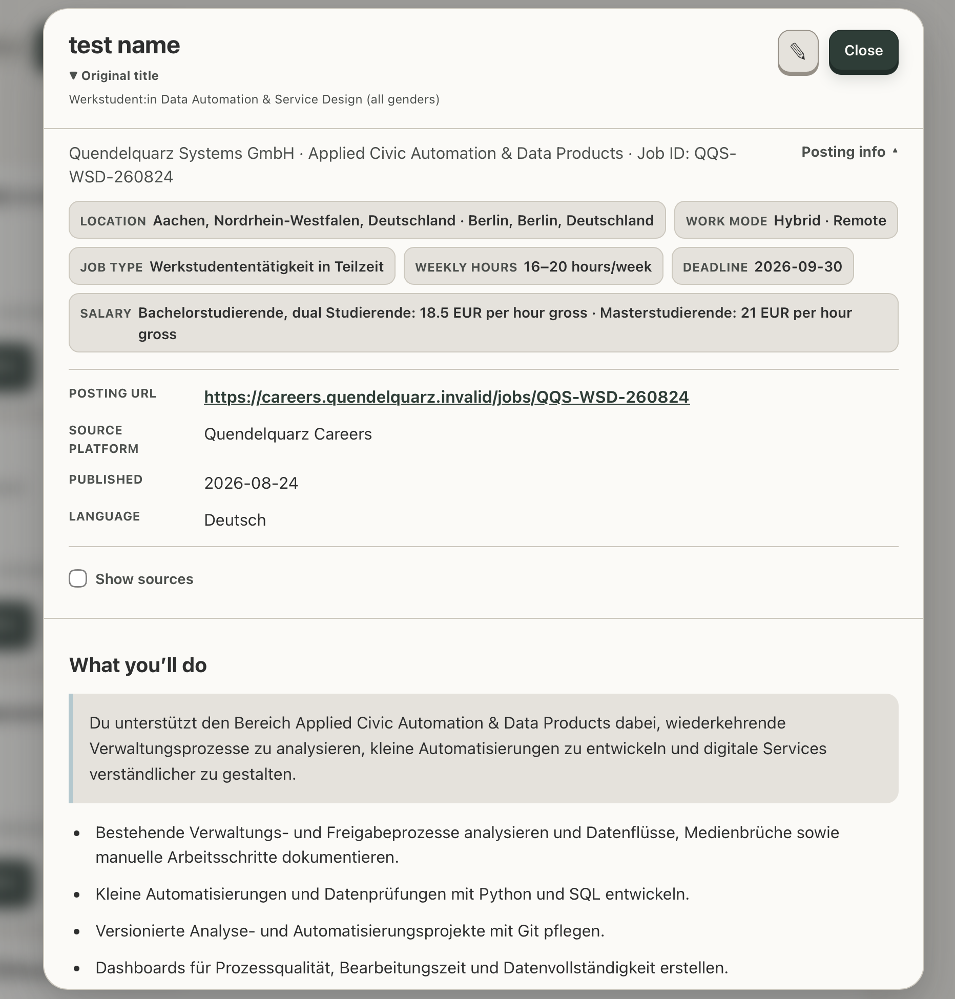
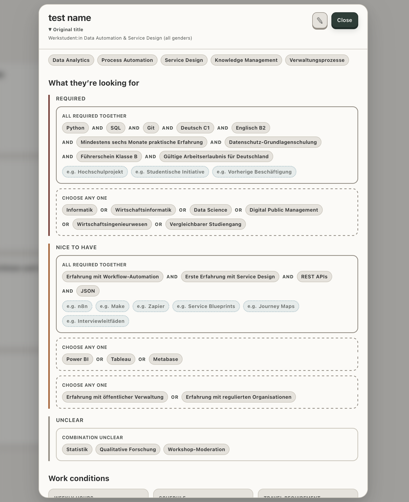
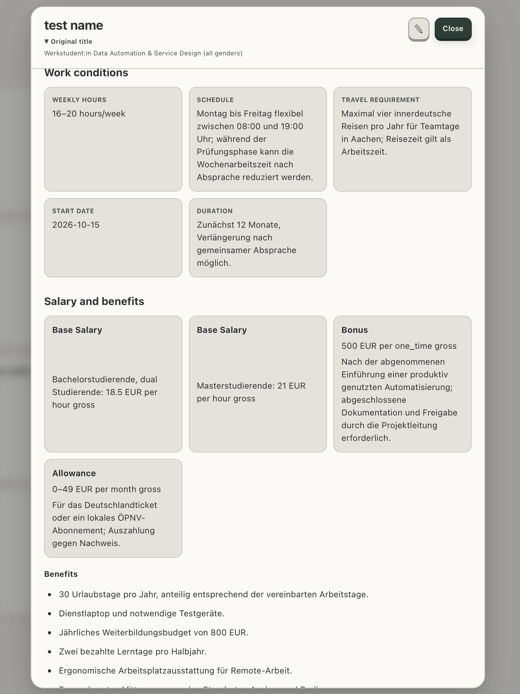
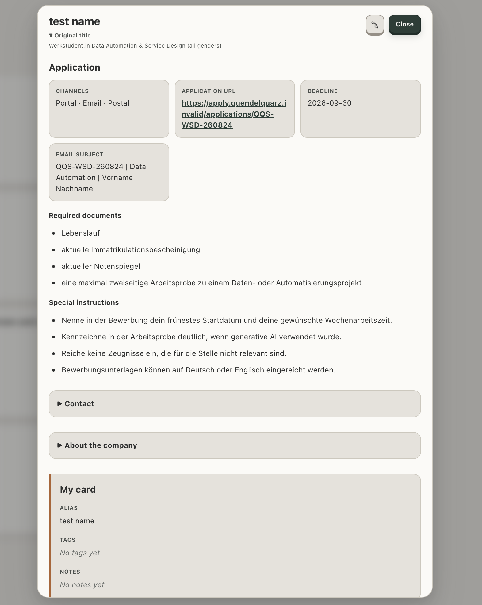

# Tracer

[](https://github.com/dylanxc-cnde/Tracer/actions/workflows/ci.yml)

**Turn messy job pages into job cards you can actually review.**

Tracer is a local-first job-search workspace, built with internships,
working-student roles, HiWi jobs, and thesis openings in Germany in mind.
Paste a posting, review what the AI picked out, and keep the useful parts
together—with sources, your corrections, tags, and notes.

Less digging through job pages. More time deciding which roles are worth a look.

## A look inside

These screenshots use a fictional posting and show an earlier layout and typography;
newer features such as inline editing and Show original aren't pictured yet.

| Overview | Requirements |
| --- | --- |
| [](docs/images/card_overview.png) | [](docs/images/card_requirements.png) |
| Work conditions and salary | Application details and notes |
| [](docs/images/card_workconditions.png) | [](docs/images/card_application.png) |

## What you can do now

- Import pasted posting text, review AI-extracted candidates, and save a Card.
  URL imports are also available through the API.
- Reopen Cards from a local SQLite library and check their source excerpts.
- Edit titles, company names, posting information, responsibilities, requirements,
  compensation, application details, contacts, company information, and personal notes.
- Add, edit, and delete requirement pills, including switching them to examples.
- Save everything together, cancel a draft, or view the initial Card snapshot.
- Read, change, or clear your display name in Settings → Profile.

Quick Facts stays a read-only summary. Requirement categories are also read-only
for now; moving pills or groups and changing existing group rules are deferred.
Failed saves keep your draft, and editing never overwrites the initial snapshot.

The browser app currently has Home, Import Posting, Card Library, Activity,
Import History, and Settings. Profile loads the saved display name and saves
changes only when you select Save changes; Cancel restores the last saved name.
Leaving Profile discards unsaved edits. API Settings manages provider metadata
and write-only credentials and selects the provider/model for posting parsing.
The separate Activity page remains a placeholder. Home reads your saved display
name and local shared records: tasks, scheduled events, explicit applications,
recent saved jobs and recorded workspace operations. Add task, Complete,
Add/Adjust event and Record application use inline controls; saving a job never
creates an application. The annual activity calendar uses recorded operations,
with earlier dates marked not recorded, not demo history. AI usage distinguishes
budget preferences from unobtained token/cost records. Discover, recommendations,
Market brief and Ask Tracer remain disabled layout previews.
It's not yet a packaged desktop app.

The Home frontend source is pending browser/static validation and visual review;
previous green Settings/Profile evidence is not a passing run for this change.
See [Home records](docs/home.md) for API contracts, failure/retry behavior and
the separate backup/validation approval required before real-database
activation. Development and screenshots use synthetic records, not your database.

## Run locally

You'll need Python 3.12, [uv](https://docs.astral.sh/uv/), and Node.js 22.

From the repository root, put `OPENAI_API_KEY=your-key` in an ignored
`.env.local` file, then start the backend:

```bash
uv sync
uv run --env-file .env.local fastapi dev src/tracer/api/app.py
```

In another terminal:

```bash
cd frontend
npm ci
npm run dev
```

Open **http://localhost:5173**. API docs are at **http://127.0.0.1:8000/docs**.
Card Library loads saved cards when you enter the page; use its refresh arrow to
reload them manually. In Import History, use the Load button to fetch saved records.

Analyze sends the posting input to OpenAI and uses paid API credits. API Settings
can select a saved OpenAI provider/model for future Analyze requests; clearing
that selection restores the environment credential and built-in model path.
DeepSeek provider configuration is retained for compatibility but is not supported
for posting parsing. Monthly budgets are saved preferences, not spending limits.
Saved records and non-secret settings live in `.local/tracer.sqlite3`; provider
keys are held separately in the current OS user's credential store. Older database schemas need a
manual, backed-up migration. Automatic upgrades aren't available yet.

## Development

The stack is React + TypeScript + Vite, FastAPI + Pydantic, and SQLite.
Parsing uses the OpenAI Responses API. A fictional parser example lives in
[examples/try_posting_parse.py](examples/try_posting_parse.py).

The interface uses [Inter](https://fonts.google.com/specimen/Inter),
bundled locally via [Fontsource](https://fontsource.org/fonts/inter).
Inter is by The Inter Project Authors and is licensed under the SIL Open Font
License 1.1. Its full copyright and license notice is retained in
[third-party licenses](frontend/public/third-party-licenses/inter.txt)
and included in the frontend build. Characters outside its coverage, including
Chinese, fall back to system sans-serif fonts. PT Serif remains installed for
possible future use, but is not loaded by the interface.

The app navigation, Home, and Settings use [Tabler Icons](https://tabler.io/icons/)
via `@tabler/icons-react` (MIT), with outline icons and the default stroke width of 2.
The full copyright and license notice is retained in
[third-party licenses](frontend/public/third-party-licenses/tabler-icons.txt)
and included in the frontend build. Framework7 Icons remains installed for
comparison, but these views no longer import it.

The Home activity heatmap uses
[React Activity Calendar](https://github.com/grubersjoe/react-activity-calendar)
(`react-activity-calendar`) by Jonathan Gruber, licensed under the MIT License.
Its font and colors are adapted to Tracer's interface. The full copyright and
license notice is retained in
[third-party licenses](frontend/public/third-party-licenses/react-activity-calendar.txt)
and included in the frontend build.

Run backend checks from the repository root:

```bash
uv run pytest
```

Then, from `frontend/`:

```bash
npm ci
npm run lint
npm run build
npx playwright install chromium
npm run test:browser
```

CI is configured to run lint, build, and the browser command on pushes and pull
requests; this does not prove a particular commit's remote CI passed. The earlier
`066cd76` behavior snapshot reported 21 Chromium tests; that is historical evidence,
not the latest count. On the later stage-three snapshot, `npm run test:browser`
reported 25 passed in each of two runs. This includes 19 mocked real-App Settings
interactions, five existing provider-creation cases and the bridge to the existing
16-case React component suite (see [Settings tests](frontend/tests/README.md)).
Four added App scenarios cover Profile load failure/retry followed by a save
consumed by Home and re-entry; parsing validation, pending-save protection,
failure retention and re-entry; and lost provider-edit and parsing-selection
responses reconciled by explicit refresh without automatic retry. Existing profile,
provider-management, reference-protected deletion and parsing-selection flows remain
included. Browser requests are closed mocks, not a real backend or credential-store test.

The component-suite bridge checks all 16 result entries and includes each failing
component's text in assertion errors. An isolated `mutation_duplicate` run detects
the synchronous duplicate-submit guard: its expected red assertion contains the
component failure text `Duplicate submission`; the subsequent normal browser run
passed. This mutation concerns the existing creation component, not the new
management flows. The request layer separately reported 28 passing Node tests.
The native idle-dialog case has no independent mutation evidence. Non-finite
budgets and native number-input `badInput` are not automated. Management dialogs
have no dedicated idle close/focus mutation. Empty reopened key fields do not prove
secure memory erasure. A passing build alone is not browser-interaction coverage.
The browser suite does not validate real backend persistence, system credential
storage, external providers, other browsers, responsive or visual acceptance;
see
[Settings tests](frontend/tests/README.md).

## Next

Continue improving Home and the dashboard, then bring layouts, controls, and
motion into one consistent interface.

Category editing and Requirements movement stay on hold until that interaction
design is clearer. For now, the priority is keeping the card compact and usable,
not squeezing more controls into every pill.

After that: candidate profiles, job-search goals, and explainable matching.
Address selection, maps, application timelines, and a desktop release are
later work—not features already available.

Tracer helps you organize and review applications. It won't submit them for you.
